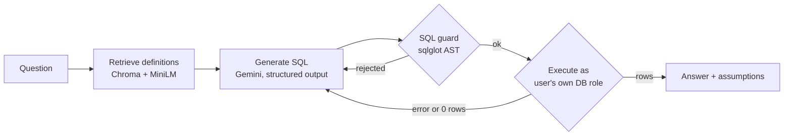

# Rx Commercial Insights: a secure text-to-SQL agent for pharma prescribing data

Ask questions about **real Medicare prescribing data** in plain English. For example: *"Which cardiologists write the most anticoagulant claims but give Eliquis less than half of them?"* The agent retrieves the business definitions it needs, writes SQL, checks the SQL, runs it, repairs it when it fails, and explains the answer along with the assumptions behind it.

Each territory manager sees **only their own territory's data**. Postgres enforces that with row-level security, so it doesn't rely on the prompt or the app.

## The problem

Commercial teams in pharma ask the same kinds of questions every week: market share, which doctors to target, which specialties drive a brand, how a brand is trending. Today, each question goes into an analyst's queue. Plain text-to-SQL tools answer instantly, but in practice they have three problems:

1. **Confident wrong answers.** A filter like `class_name LIKE '%anticoagulant%'` runs without error and returns nothing, because the data calls the class *"Direct factor Xa inhibitors"*.
2. **Inconsistent metrics.** "Market share", "deciles" and "new writers" each have one correct definition, and a model will improvise its own.
3. **Data access.** A territory manager must never see another territory's prescribers, whatever question is asked.

This project addresses each one.

## Data

**CMS Medicare Part D Prescribers, by Provider and Drug.** This is public US-government data. The project uses the Connecticut subset for 2021–2023:

| Table | Rows | What it holds |
|---|---|---|
| `prescriptions` | 929,995 | Claims, 30-day fills, drug cost and patients, per prescriber × drug × year |
| `prescribers` | 18,634 | Healthcare providers (HCPs), with specialty, city and territory |
| `drugs` | 2,073 | Brand and generic names, with WHO ATC therapeutic class (covers 99% of claims) |
| `territories` | 7 | 6 sales territories plus one "unaligned" group |

**Territory design.** The territories come from k-means clustering on city coordinates, weighted by the number of prescribers in each city. They're named after their largest city. k-means optimizes for geographic compactness, not workload, so the territories are unbalanced: Hartford has 6,319 HCPs and Norwich has 1,533. Real territory alignment would also balance workload. The 37 prescribers whose city couldn't be geocoded go into an `UNALIGNED` group, which only the national role can see.

**Data quirks the agent is taught about:**
- CMS removes rows with fewer than 11 claims.
- 59% of patient counts are suppressed for privacy.
- Patient counts must never be summed across rows.
- The data has no NRx (new prescriptions), only total claims.

## Architecture



| Component | What it does | Why |
|---|---|---|
| [agent/graph.py](agent/graph.py) | LangGraph state machine with a self-correction loop (up to 2 retries) | A database error such as `column "p.npi" does not exist` tells the model exactly what to fix. |
| [knowledge/glossary.md](knowledge/glossary.md) | Business definitions with approved SQL patterns: market share, volume-based deciles, targeting, growth, market name → ATC code | Gives one definition per metric, so the model follows it instead of improvising. |
| [agent/knowledge.py](agent/knowledge.py) | Retrieves the 4 most relevant definitions per question | The embedding model runs locally on CPU (ONNX), so retrieval costs nothing. The index rebuilds automatically when the glossary changes. |
| [agent/guard.py](agent/guard.py) | Parses the SQL into a syntax tree. It allows exactly one read-only query on known tables, blocks `set_config`/`pg_sleep`, and adds `LIMIT 500` | Replaces the old keyword check. That check missed `update\n` and wrongly flagged the word "UPDATE" inside a string. |
| [db/security.sql](db/security.sql) | Row-level security policies keyed on `current_user` | The security boundary (see below). |
| [app.py](app.py) | Streamlit chat with auto-charts, CSV download, and a "How I got this" panel showing the SQL, failed attempts and definitions used | Users can check the logic without reading SQL. |

**Three failure modes I found in testing and fixed:**
- **Empty results.** A query that returns 0 rows is treated as suspicious. The model re-checks its filters once. If it stands by the query, the empty result is accepted. That's correct when, for example, row-level security hides another territory's data.
- **Hidden assumptions.** "Anticoagulant claims" summed across 2021–2023 including warfarin (2,545 claims) and the same question for 2023 DOACs only (773) are both valid SQL. The answer now always states the period and market definition it used, and the default period is the latest year.
- **Rules that depended on retrieval.** For "What was Eliquis's market share?", the glossary entry that maps markets to ATC codes ranked 8th of 14, so it was never retrieved, and the model sometimes defined the market too narrowly. Rules needed by almost every question (which codes make up each market, and the default year) now live in the schema's column comments, which are always in the prompt. Retrieval only supplies situational definitions such as deciles, targeting and growth.

## Security: enforced by the database, not the prompt

Each manager logs in as their own Postgres role (`mgr_hartford`, `rx_national`, …). Row-level security policies filter `prescribers` and `prescriptions` by `current_user`. The roles are also:
- **read-only:** they have only `SELECT` and `default_transaction_read_only`
- **time-limited:** `statement_timeout = 15s`
- **scoped:** they can't see the other schemas

Why not a filter in the prompt, or a session variable? A prompt can be ignored. A session variable can be overwritten by the generated SQL itself, because `SELECT set_config(...)` is valid SQL. `current_user` is fixed at login.

[tests/test_rls.py](tests/test_rls.py) runs these attacks as the Norwich manager:

| Attempt | Result |
|---|---|
| `SELECT count(*) FROM prescribers` | 1,533 (national sees 18,634) |
| `... WHERE territory_id = 'T-HARTFORD'` | 0 |
| `SELECT set_config('app.territory','T-HARTFORD',false), (SELECT count(*) FROM prescribers)` | Variable set, still 1,533 |
| `SET ROLE rx_national` | permission denied |
| `UPDATE drugs ...` | read-only transaction |
| `SELECT ... FROM public.opportunities` | permission denied |
| `SELECT pg_sleep(20)` | cancelled by statement timeout |

## Evaluation on BIRD

[eval/bird_eval.py](eval/bird_eval.py) scores the same agent core on **BIRD Mini-Dev**, the standard public text-to-SQL benchmark: 500 questions across 11 databases, graded by execution accuracy against gold queries.
- A stratified 150-question sample, with a fixed seed.
- Every attempt is logged, so a single run gives both first-try accuracy and self-corrected accuracy.
- An optional `--no-evidence` run removes BIRD's per-question hints. It measures what domain knowledge is worth, which is the same job the glossary does here.
- The run is resumable, so free-tier quotas can be spread across days.

*Results: pending.*

## Run it locally

```bash
python -m venv venv && venv\Scripts\activate      # Windows
pip install -r requirements.txt
copy .env.example .env                             # fill in DB_PASSWORD, RX_ROLE_PASSWORD, GOOGLE_API_KEY

python scripts/download_data.py                    # ~13 MB of Parquet, Connecticut 2021-2023
python scripts/load_rx.py                          # schema, territories, 930k rows, RLS, logins
python tests/test_rls.py                           # every attack should be blocked
python tests/test_guard.py

streamlit run app.py
python scripts/ask.py mgr_hartford "Top 10 GLP-1 prescribers in 2023"   # terminal alternative
```

A free Gemini API key is enough. Each Gemini model has its own daily free quota, so `GOOGLE_MODELS` chains several of them with LangChain fallbacks. When one model's quota runs out, the next one answers.

## Deploy for free

1. **Database:** create a free [Neon](https://neon.tech) Postgres project (the data is 163 MB; the free limit is 500 MB). Put its host, user, password and database in `.env` with `DB_SSLMODE=require`, then run `python scripts/load_rx.py` from your machine.
2. **App:** on [Streamlit Community Cloud](https://streamlit.io/cloud), deploy `app.py` from this repo with Python 3.11. Add the `.env` values as secrets. Streamlit exposes top-level secrets as environment variables, so no code changes are needed.
3. **Cost guard:** each browser session is capped at `SESSION_QUESTION_LIMIT` questions.

## Limitations

- **Medicare Part D only.** It mostly covers patients 65 and over, and not commercial insurance or Medicaid, so it's a sample of the market. Drug cost is gross of rebates.
- **Silent wrong answers still happen.** A query can run cleanly and return the wrong rows, and self-correction can't catch that because there's no error. The mitigations are glossary definitions, disclosed assumptions and a visible SQL panel, which reduce the problem but don't eliminate it.
- **Sign-in is a demo.** The app lets you pick a role. In production, single sign-on would map each user to their database role.
- **Territories are illustrative.** They aren't balanced for workload.

## Project layout

```
agent/        graph.py (LangGraph), guard.py, db.py (Postgres + SQLite), knowledge.py, llm.py
app.py        Streamlit UI
db/           schema.sql (documented with COMMENTs the agent reads), security.sql (RLS)
knowledge/    glossary.md: business definitions
scripts/      download_data.py, load_rx.py, ask.py
eval/         bird_eval.py
tests/        test_rls.py, test_guard.py
```
